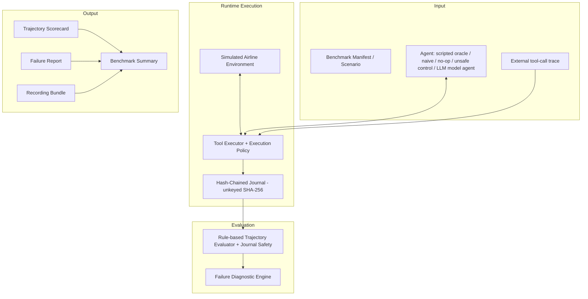

# Flight Agent Evaluator — Architectural Overview

## System purpose

Flight Agent Evaluator runs tool-using agents against a simulated airline back end, records each run in a hash-chained journal, scores it with rules, and can re-execute it to check that it reproduces. It has six parts:

1. **Deterministic execution.** An in-memory simulated environment with state machines, idempotency keys and approval checks. Each scenario declares its approval decision, and an unconfigured decision fails closed to `DENIED` ([`transactional-environment.md`](transactional-environment.md)).
2. **Trajectory evaluation.** Rule-based matching of tool calls against authored expectations, outcome assertions on state rebuilt from the journal, and journal safety checks on every run: approvals, denied attempts, duplicate side effects, unbacked success claims and untrusted instructions ([`evaluation.md`](evaluation.md)).
3. **Failure diagnostics.** Failure codes, severities and origins assigned by rules from the scorecard, with root causes chosen by journal-order heuristics.
4. **Replay.** Unkeyed SHA-256 hash-chained journals, bundle manifests, and re-execution compared on semantic events, including tool result values ([`replay.md`](replay.md)).
5. **External trace evaluation.** Tool-call traces from other agent frameworks are re-executed and scored by the same pipeline (`traces/`).
6. **Packaged distribution.** Built-in scenarios, expectations and manifests ship as package data, and the platform runs offline.

What these results do and do not show is listed in [`../methodology/limitations.md`](../methodology/limitations.md).

The qualitative judge (`judges/`) is **not** part of this flow; the evaluator and the benchmark never call it. It can only be run on its own with `flight-evaluator judge score --mode fake|replay`. No live judge client exists ([`../methodology/judge-validation.md`](../methodology/judge-validation.md)).

## Core subsystems

| Subsystem | Package | What it does |
| --- | --- | --- |
| **Contracts** | `flight_agent_evaluator.contracts` | Pydantic v2 models for entities, scenarios (including the `environment` block), events, expectations, scorecards, failure details, and model exchanges. Schema version `0.4.0` across results and run artifacts. |
| **Environment** | `flight_agent_evaluator.environment` | Simulated booking engine: holds, approval checks and an idempotency registry, configured only from the scenario's `environment` block. |
| **Tools** | `flight_agent_evaluator.tools` | 11 typed tools, each with a mutation class and JSON-schema checks. The allowlist comes from `default_allowed_tools` (`tools/base.py:191-209`) and is never derived from the golden trajectory. |
| **Engine** | `flight_agent_evaluator.engine` | Scenario loader; runner applying scenario time limits (`engine/runner.py`); tool executor; fault engine; benchmark runner. Enforces strict JSON, a 64 KiB argument size limit, rejection of non-finite numbers (`_finite_json`), argument validation strictly before fault injection, cancellation journaled as an unknown outcome, and journaling of over-budget calls (`_budget_exhausted`). |
| **Agent** | `flight_agent_evaluator.agent` | Scripted baselines (`scripted-oracle`, `naive-baseline`, `no-op-baseline`, `unsafe-baseline`) and `ModelToolCallingAgent` (`agent/loop.py`). Tracks model provenance and `configuration_digest`; enforces per-call model timeouts; supports exact replay of malformed calls (`raw_arguments`, `arguments_error`); and refuses secret-bearing exchange manifests (`agent/security.py`: `sk-` keys need a left boundary, custom secrets must be ≥ 12 characters). |
| **Traces** | `flight_agent_evaluator.traces` | Imports external tool-call traces (`traces/format.py`) and re-executes them through the real `ToolExecutor`. Enforces strict trace containment (rejecting absolute paths, Windows drive letters, parent traversal `..`, and symlink ancestors) with optional `--allow-root` directory grant. Untrusted agent reports are recorded as divergences (`traces/evaluate.py`). |
| **Providers** | `flight_agent_evaluator.providers` | `FixtureFlightProvider`. There are no live provider adapters. |
| **Evaluation** | `flight_agent_evaluator.evaluation` | Branch-and-bound matcher; journal safety and claims checks (excluding read-outs, questions/offers, and third-party actions); safety-capped scoring; rule-based failure diagnostics with structured `failure_details`; and Validation v2 harness (`evaluation/validation/`) with dev/heldout split, contamination guard, Wilson 95% CIs, and small-n suppression. |
| **Judges** | `flight_agent_evaluator.judges` | Evidence-package contracts, a 0–4 rubric, fake and replay clients, agreement metrics and calibration statuses. There is no live client, no recorded exchanges and 0 human annotations. |
| **Recording & Replay** | `flight_agent_evaluator.recording`, `flight_agent_evaluator.replay` | `.jsonl` journal, `.meta.json`, `.bundle.json` manifest; re-execution and `semantic-events-v2` comparison; verify exit codes 0/1/3. Recordings are isolated by agent `configuration_digest`. |
| **Benchmarks** | `flight_agent_evaluator.benchmarks` | Manifest loading with digest checks, corpus validation, multi-agent execution, aggregate metrics, consistency recomputation, release verification, and deterministic run comparisons (`compare_runs`, CLI: `benchmark compare`). Authored expectations are strictly required unless opted out via `allow_development_expectation`. Agent crashes yield `AGENT.EXECUTION_ERROR` per case while the suite continues. |
| **Resources** | `flight_agent_evaluator.resources` | Packaged scenarios (24), expectations (24), benchmark manifests and fixtures. |
| **CLI** | `flight_agent_evaluator.cli` | Unified CLI (`cli/main.py:1229-1595`): `scenario validate`, `agents list/describe`, `trajectory validate/score/explain/diagnose`, `demo`, `benchmark list/run/validate/report/compare/verify-release`, `annotation validate/workflow`, `judge score`, `run`, `replay`, `verify`, `evaluate`, `trace evaluate [--allow-root]`, `evaluator validate [--suite dev|heldout] [--dev-report]`. Gating flags on `benchmark run` (`--fail-under-success`, `--require-safety`, `--baseline`, `--max-regression`) with exit codes: 0 pass, 1 gate failed, 2 input/usage error, 3 evaluator error. |
| **SDK Surface** | `flight_agent_evaluator` | The public SDK surface is strictly exported in `flight_agent_evaluator.__all__` (`src/flight_agent_evaluator/__init__.py:50-76`), guaranteeing backwards compatibility across minor releases. |
