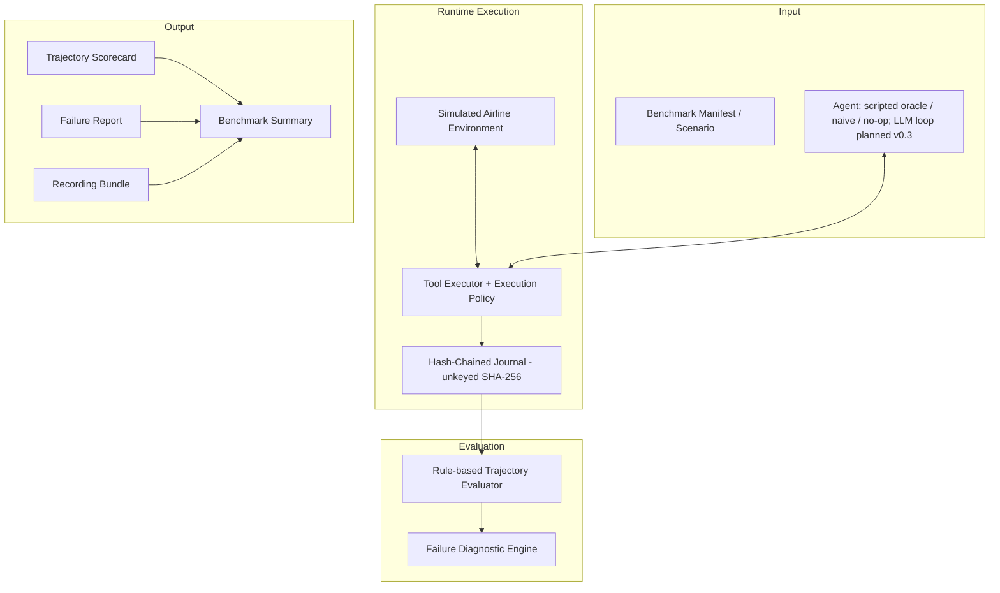

# Flight Agent Evaluator — Architectural Overview

## System purpose

Flight Agent Evaluator runs tool-using agents against a simulated airline back end, records each run in a hash-chained journal, scores it with rules, and can re-execute it to check that it reproduces. It has five parts:

1. **Deterministic execution.** An in-memory simulated environment with state machines, idempotency keys and approval checks. Approval decisions come from a per-scenario table, not a human ([`transactional-environment.md`](transactional-environment.md)).
2. **Trajectory evaluation.** Rule-based matching of tool calls against authored expectations, outcome assertions on state rebuilt from the journal, and glob- and selector-based safety rules ([`evaluation.md`](evaluation.md)).
3. **Failure diagnostics.** Failure codes, severities and origins assigned by rules from the scorecard, with root causes chosen by journal-order heuristics.
4. **Replay.** Unkeyed SHA-256 hash-chained journals, bundle manifests, and re-execution compared on semantic events. Tool output values are not yet compared ([`replay.md`](replay.md)).
5. **Packaged distribution.** Built-in scenarios, expectations and manifests ship as package data, and the platform runs offline.

What these results do and do not show is listed in [`../methodology/limitations.md`](../methodology/limitations.md).

The qualitative judge (`judges/`) is **not** part of this flow. The evaluator and the benchmark never call it. It can only be run on its own with `flight-evaluator judge score`, and its default client is a fake that returns constant scores ([`../methodology/judge-validation.md`](../methodology/judge-validation.md)).

## Core subsystems

| Subsystem | Package | What it does |
| --- | --- | --- |
| **Contracts** | `flight_agent_evaluator.contracts` | Pydantic v2 models for aviation entities, scenarios, events and trajectory expectations. |
| **Environment** | `flight_agent_evaluator.environment` | Simulated booking engine: holds, approval checks, idempotency registry. Approval outcomes are hardcoded per scenario ID and default to `APPROVED`; fail-closed approvals are **planned in v0.3 (in progress)**. |
| **Tools** | `flight_agent_evaluator.tools` | 11 typed tools (`flight.get_status`, `flight.search_flights`, `booking.hold_alternative`, `approval.request`, `booking.confirm_rebooking`, …), each with a mutation class and a JSON-schema check on its input. |
| **Engine** | `flight_agent_evaluator.engine` | Scenario loader, runner, tool executor, fault engine and benchmark runner. The tool allowlist given to an agent comes from the scenario's scripted trajectory (`engine/benchmark.py:193-198`). |
| **Agent** | `flight_agent_evaluator.agent` | Scripted baselines (`baselines.py`) and an LLM tool-calling loop (`loop.py`, `model_client.py`). No LLM run has been recorded; a working LLM adapter is **planned in v0.3 (in progress)**. |
| **Providers** | `flight_agent_evaluator.providers` | Only `FixtureFlightProvider`. There are no live provider adapters. |
| **Evaluation** | `flight_agent_evaluator.evaluation` | Exhaustive capped matcher, weighted composite score, rule-based diagnostics, template explanations. |
| **Judges** | `flight_agent_evaluator.judges` | Evidence-package contracts, 0–4 rubric, fake and replay clients, agreement metrics. No live client, no recorded exchanges, 0 human annotations. |
| **Recording & Replay** | `flight_agent_evaluator.recording`, `flight_agent_evaluator.replay` | `.jsonl` journal, `.meta.json`, `.bundle.json` manifest; re-execution and semantic comparison. |
| **Benchmarks** | `flight_agent_evaluator.benchmarks` | Manifest loading with digest checks, corpus validation, multi-agent execution, aggregate metrics, release verification. The ablation pipeline was removed (`tests/unit/test_release_truth_regressions.py:50-63`). |
| **Resources** | `flight_agent_evaluator.resources` | Packaged scenarios (24), expectations (24), manifests and fixtures. |
| **CLI** | `flight_agent_evaluator.cli` | `run`, `replay`, `verify`, `evaluate`, `benchmark`, `agent run`, `agents`, `judge score` (`cli/main.py:1071-1290`). |
