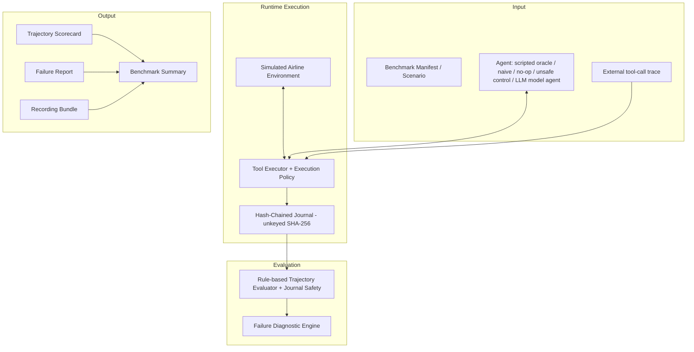

# Flight Agent Evaluator — Architectural Overview

## System purpose

Flight Agent Evaluator runs tool-using agents against a simulated airline back end, records each run in a hash-chained journal, scores it with rules, and can re-execute it to check that it reproduces. It has six parts:

1. **Deterministic execution.** An in-memory simulated environment with state machines, idempotency keys and approval checks. Each scenario declares its approval decision, and an unconfigured decision fails closed to `DENIED` ([`transactional-environment.md`](transactional-environment.md)).
2. **Trajectory evaluation.** Rule-based matching of tool calls against authored expectations, outcome assertions on state rebuilt from the journal, and journal safety checks on every run: approvals, denied attempts, duplicate side effects, unbacked success claims and untrusted instructions ([`evaluation.md`](evaluation.md)).
3. **Failure diagnostics.** Failure codes, severities and origins assigned by rules from the scorecard, with root causes chosen by journal-order heuristics.
4. **Replay.** Unkeyed SHA-256 hash-chained journals, bundle manifests, and re-execution compared on semantic events, including tool result values ([`replay.md`](replay.md)).
5. **External trace evaluation.** Tool-call traces from other agent frameworks are re-executed and scored by the same pipeline (`traces/`).
6. **Packaged distribution.** Built-in scenarios, expectations and manifests ship as package data, and the platform runs offline.

What these results do and do not show is listed in [`../methodology/limitations.md`](../methodology/limitations.md).

The qualitative judge (`judges/`) is **not** part of this flow; the evaluator and the benchmark never call it. It can only be run on its own with `flight-evaluator judge score --mode fake|replay`. No live judge client exists ([`../methodology/judge-validation.md`](../methodology/judge-validation.md)).

## Core subsystems

| Subsystem | Package | What it does |
| --- | --- | --- |
| **Contracts** | `flight_agent_evaluator.contracts` | Pydantic v2 models for entities, scenarios (including the `environment` block), events, expectations and model exchanges. |
| **Environment** | `flight_agent_evaluator.environment` | Simulated booking engine: holds, approval checks and an idempotency registry, configured only from the scenario's `environment` block. |
| **Tools** | `flight_agent_evaluator.tools` | 11 typed tools, each with a mutation class and a JSON-schema check on its input. The allowlist comes from `default_allowed_tools` (`tools/base.py:191-209`) and is never derived from the golden trajectory. |
| **Engine** | `flight_agent_evaluator.engine` | Scenario loader; runner, which defaults to the fixture provider and applies the scenario time limit (`engine/runner.py:46-47,157`); tool executor; fault engine; benchmark runner. |
| **Agent** | `flight_agent_evaluator.agent` | Scripted baselines, including the `unsafe-baseline` negative control (`agent/baselines.py`). Also the LLM agent `ModelToolCallingAgent` (`agent/loop.py:33`), which runs through `OpenAIChatCompletionsClient` in live/record mode (`agent/model_client.py:158`) or through `ReplayModelClient` (`:370`). Tool names are mapped `.` ↔ `__` (`agent/tool_names.py`). No real model run is committed. |
| **Traces** | `flight_agent_evaluator.traces` | Imports external tool-call traces (`traces/format.py`) and re-executes them through the real `ToolExecutor`. Agent-reported results are treated as untrusted and differences are recorded as divergences. Scores the run with the benchmark pipeline (`traces/evaluate.py:123-157`). |
| **Providers** | `flight_agent_evaluator.providers` | Only `FixtureFlightProvider`. There are no live provider adapters. |
| **Evaluation** | `flight_agent_evaluator.evaluation` | Branch-and-bound matcher; journal safety and claim checks; safety-capped scoring; rule-based diagnostics; evaluator validation harness (`evaluation/validation/`). |
| **Judges** | `flight_agent_evaluator.judges` | Evidence-package contracts, a 0–4 rubric, fake and replay clients, agreement metrics and calibration statuses. There is no live client, no recorded exchanges and 0 human annotations. |
| **Recording & Replay** | `flight_agent_evaluator.recording`, `flight_agent_evaluator.replay` | `.jsonl` journal, `.meta.json`, `.bundle.json` manifest; re-execution and `semantic-events-v2` comparison; verify exit codes 0/1/3. |
| **Benchmarks** | `flight_agent_evaluator.benchmarks` | Manifest loading with digest checks, corpus validation, multi-agent execution, aggregate metrics, consistency recomputation, release verification. |
| **Resources** | `flight_agent_evaluator.resources` | Packaged scenarios (24), expectations (24), benchmark manifests and fixtures. |
| **CLI** | `flight_agent_evaluator.cli` | `scenario validate`, `agents list/describe`, `agent run`, `trajectory validate/score/explain/diagnose`, `demo`, `benchmark list/run/validate/report/verify-release`, `annotation validate`, `judge score`, `run`, `replay`, `verify`, `evaluate`, `trace evaluate`, `evaluator validate` (`cli/main.py:1119-1391`). |
